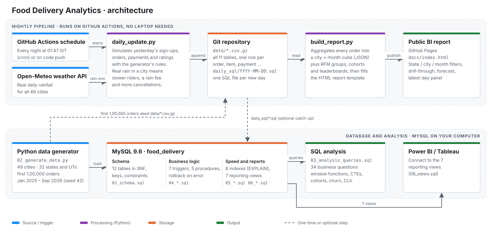
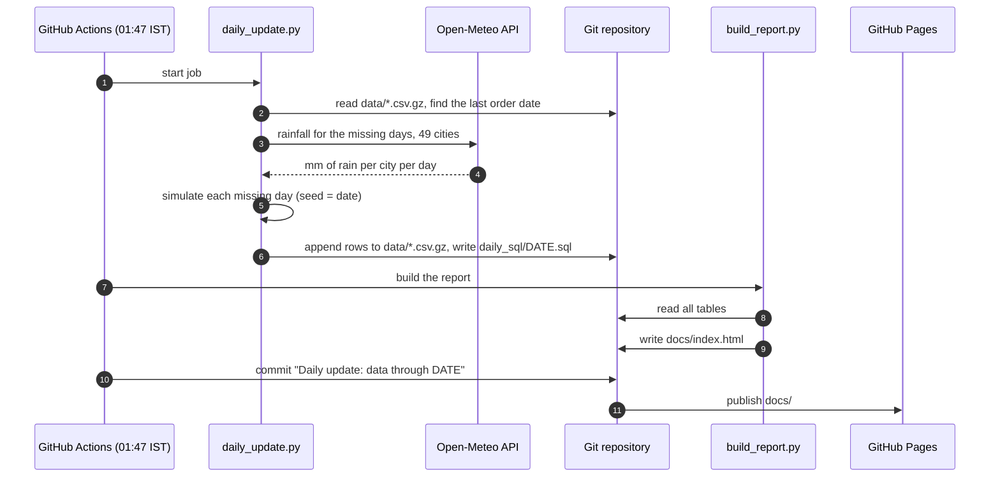
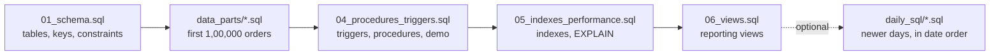

# Architecture

<picture>
  <source media="(prefers-color-scheme: dark)" srcset="images/architecture_dark.png">
  
</picture>

The project has two halves that share one dataset:

1. **A nightly pipeline** on GitHub Actions that adds a new day of orders and republishes the public report. It runs on GitHub's servers, so no laptop needs to be on.
2. **A MySQL database** with the schema, business logic, indexes and reporting views, which the SQL analysis and BI tools read.

---

## Components

| Layer | Component | What it does |
|---|---|---|
| Source | `02_generate_data.py` | Generates the first 1,00,000 orders (Jan 2025 – Sep 2026) across 49 cities in all 32 states and UTs, with a fixed seed so the output is reproducible. |
| Source | Open-Meteo API | Free weather service. Gives the real rainfall of the previous day for every city. |
| Trigger | `.github/workflows/daily-update.yml` | Runs every night at 01:47 IST, and also when the pipeline code changes. |
| Processing | `pipeline/daily_update.py` | Fills in every missing day up to yesterday: new sign-ups, orders, items, payments and ratings, following the generator's rules. Real rain in a city slows riders, adds a rain fee and raises cancellations. |
| Storage | `data/*.csv.gz` | All 11 tables as compressed CSV, version-controlled in Git. This is the pipeline's source of truth. |
| Storage | `daily_sql/YYYY-MM-DD.sql` | One SQL file per new day, so a local MySQL copy can catch up. |
| Processing | `pipeline/build_report.py` | Aggregates every order into a city × month "cube" (revenue, orders, hours, cuisines, delivery times, coupons, payments) plus RFM groups, cohorts and leaderboards, and injects it as JSON into `pipeline/report_template.html`. |
| Output | `docs/index.html` on GitHub Pages | The public report. All filtering (state, city, months, compare) happens in the browser, so the site needs no server. |
| Storage | MySQL `food_delivery` | 12 tables in 3NF (`01_schema.sql`), 7 triggers and 5 stored procedures with transactions (`04_procedures_triggers.sql`), 8 indexes (`05_indexes_performance.sql`), 7 reporting views (`06_views.sql`). |
| Output | `03_analysis_queries.sql` | 34 business questions answered with window functions, CTEs and pivots. |
| Output | Power BI / Tableau | Connect to MySQL and use the 7 views as data sources. |

---

## What happens each night

## One-time database setup

---

## Design decisions

- **CSV in Git as the pipeline's store.** GitHub Actions has no database, and a hosted MySQL would cost money. Compressed CSV keeps the whole dataset small enough to version (a few MB) and every daily change is visible as a commit.
- **Reproducible days.** Each day is generated with its own seed (`SEED-date`), and the generator's hidden attributes (restaurant quality and popularity, rider speed, customer activity) are rebuilt by replaying the original seed. Re-running a day gives exactly the same rows.
- **Self-healing catch-up.** The job adds every day between the last order date and yesterday, so a missed night is filled in by the next run.
- **Graceful weather fallback.** If Open-Meteo can't be reached, that day uses each region's normal monsoon months instead of failing the job.
- **Static report.** The page ships pre-aggregated JSON (about 1.3 MB) and filters in the browser, so GitHub Pages can host it for free with no backend.
- **Triggers stay in MySQL.** The daily SQL files are plain `INSERT`s, so when they are loaded into MySQL the triggers still log order statuses and keep restaurant ratings up to date.

## Honest scope

Orders, customers and restaurants are **simulated**; Swiggy and Zomato don't publish order-level data. The generator is calibrated to their public figures (average order value about ₹425–436 in Q1 FY25, UPI as the main payment method, metros taking most orders). The **rainfall is real**.
