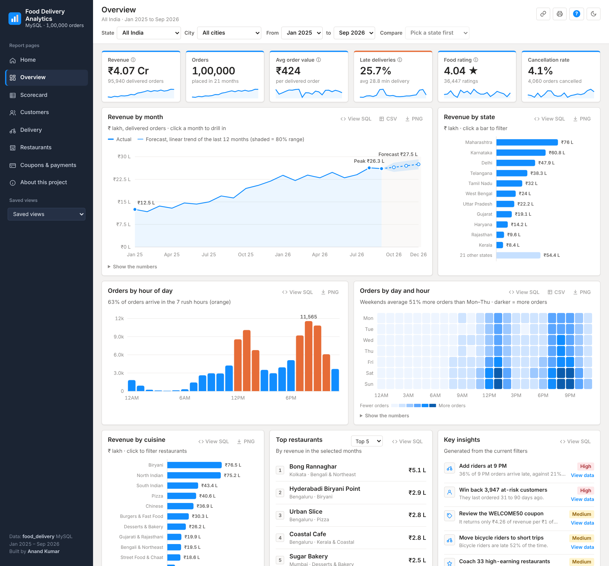
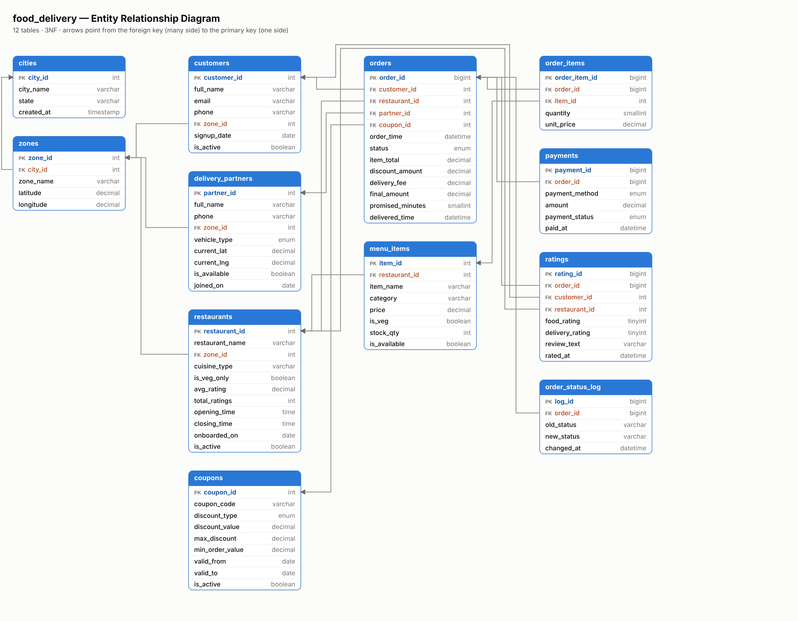
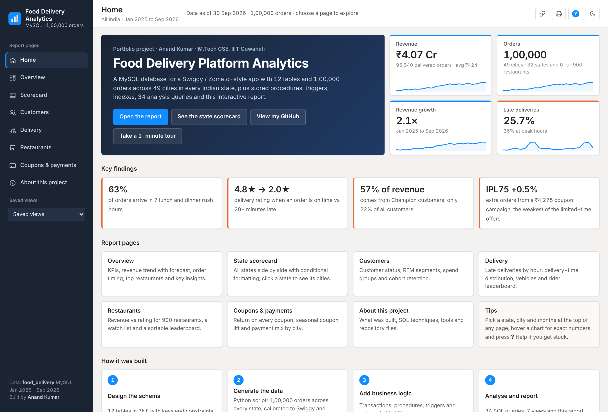
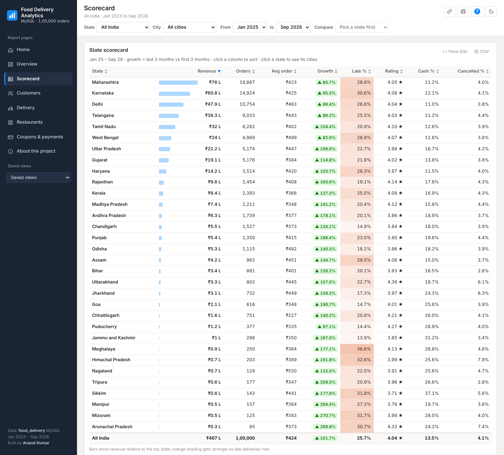
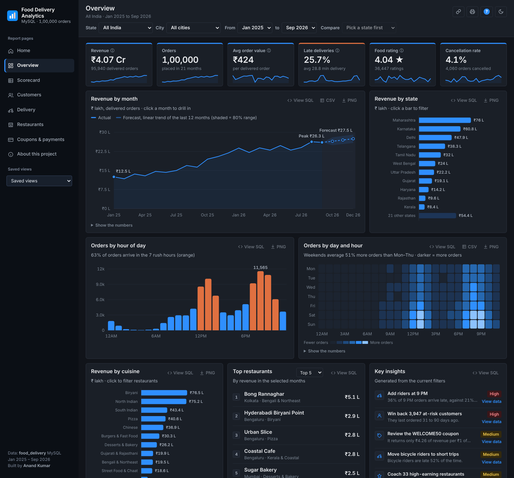

# 🍔 Food Delivery Platform — Database Design & SQL Analytics

A complete **MySQL** database behind a Swiggy / Zomato–style food delivery app: a normalized schema,
**1,00,000 realistic orders across 49 cities in every Indian state**, business logic written as **stored procedures, triggers and transactions**,
**indexes** tuned with `EXPLAIN`, **reporting views**, and **34 analysis queries** that answer real business questions.

> Built by **Anand Kumar** (M.Tech CSE, IIIT Guwahati) · MySQL 8/9 · Python · SQL window functions · CTEs

**🔴 Live report, updated every night:** https://anand201r-del.github.io/food-delivery-analytics/



---

## 📌 Highlights

| | |
|---|---|
| **Schema** | 12 tables in 3NF, primary/foreign keys, `CHECK` / `UNIQUE` / `ENUM` constraints |
| **Data** | 1,00,000 orders · 2.06 lakh order items · 20,000 customers · 900 restaurants · 2,200 riders · 49 cities in all 28 states + Delhi, Chandigarh, J&K, Puducherry · 182 real localities · 21 months |
| **Realism** | average order ≈ ₹424 (Swiggy reported ₹436, Zomato ₹425 in Q1 FY25), UPI-first payments with more cash in small cities, metros ≈ 70% of orders, regional food (dosa in the south, thalis in Gujarat, fish and momos in the east), opening hours, regional festivals (Durga Puja, Onam, Pongal, Ganesh Chaturthi, Eid, Bihu), region-specific monsoons, IPL evenings, regional names |
| **Transactions** | `sp_place_order` validates cart → locks stock → applies coupon → creates order → records payment → assigns rider, **all-or-nothing** with automatic `ROLLBACK` |
| **Triggers** | order status audit log, auto delivery timestamp, rider release, live restaurant rating, out-of-stock flag, rating validation |
| **Performance** | 8 indexes, before/after `EXPLAIN` — up to **5.7× faster** reports |
| **Analytics** | 34 queries: `RANK`, `DENSE_RANK`, `ROW_NUMBER`, `NTILE`, `LAG`, `PERCENT_RANK`, running totals, cohorts, churn, CLV |
| **Reporting** | 7 views ready for Power BI / Tableau + an HTML dashboard |

---

## 🔄 Daily data pipeline (runs by itself)

Every night at 01:47 India time a GitHub Actions job ([`.github/workflows/daily-update.yml`](.github/workflows/daily-update.yml)) runs on GitHub's servers:

1. **Fetches real rainfall** for all 49 cities for the previous day from [Open-Meteo](https://open-meteo.com) (free weather API).
2. **Generates that day's orders** (`pipeline/daily_update.py`): new sign-ups, orders, items, payments and ratings, following the same rules as the original generator (rush hours, weekends, festivals, growth, opening hours). Cities where it really rained get slower deliveries, a rain fee and more cancellations.
3. **Saves the day** to `data/*.csv.gz` and as `daily_sql/YYYY-MM-DD.sql`, so a local MySQL copy can catch up by running the new files in date order.
4. **Rebuilds the report** (`pipeline/build_report.py`) and publishes it with GitHub Pages.

Orders are simulated; the weather is real. Each day uses its own random seed, so the pipeline is reproducible. If a night is missed, the next run fills in every missing day.

---

## 🗂️ Project structure

```
Food Delivery System/
├── 01_schema.sql               # database + 12 tables, keys, constraints
├── 02_generate_data.py         # Python data generator (1 lakh orders, every state; no Faker needed)
├── data_parts/                 # the first 1,00,000 orders (Jan 2025 – Sep 2026) as 10 SQL files of ~2.6 MB
├── 03_analysis_queries.sql     # 34 business questions, with explanations
├── 04_procedures_triggers.sql  # triggers, stored procedures, transactions + live demo
├── 05_indexes_performance.sql  # indexes with EXPLAIN before / after
├── 06_views.sql                # 7 reporting views (dashboard data sources)
├── data/                       # all tables as compressed CSV, extended every night
├── daily_sql/                  # one SQL file per new day (for a local MySQL copy)
├── pipeline/                   # daily_update.py, build_report.py and the report template
├── docs/index.html             # the published report (GitHub Pages)
├── .github/workflows/          # the nightly job
└── images/                     # ER diagram + dashboard screenshots
```

---

## 🧱 Database design (ER diagram)



| Table | Purpose |
|---|---|
| `cities`, `zones` | location hierarchy: 49 cities with their state, 182 real localities with lat/long for distance calculations |
| `customers` | app users, home zone, signup date |
| `restaurants`, `menu_items` | restaurants with cuisine & live rating; dishes with price and stock |
| `delivery_partners` | riders, vehicle type, current location, availability |
| `coupons` | percent / flat discounts with min order, cap and validity window |
| `orders` | the central fact table: amounts, status, promised vs actual delivery time |
| `order_items` | order lines — stores `unit_price` **at the time of order** (price history) |
| `payments`, `ratings` | one payment and at most one rating per order |
| `order_status_log` | audit trail filled automatically by triggers |

**Normalization notes:** city is reached through `zones` (no repeated city names); order totals are stored
on `orders` because they are the *billed* amounts (coupon + fee rules can change later); item price is
copied into `order_items` so menu price changes never rewrite history.

---

## ▶️ How to run it

1. **Create the database** — open `01_schema.sql` in MySQL Workbench (connected to your local server) and run it (⚡).
2. **Load the data** — choose one:
   - **Easiest:** open and run `data_parts/02_data_part01.sql` … `part10.sql` in order. (After step 3, also run the files in `daily_sql/` in date order to add the newer days.)
   - **Python:** `pip install mysql-connector-python` then `python 02_generate_data.py` (asks for your MySQL password, loads directly).
   - `python 02_generate_data.py --sql-out 02_data.sql` writes the whole first-load data as one SQL file instead.
3. Run `04_procedures_triggers.sql` (creates logic + runs a demo, then cleans up after itself).
4. Run `05_indexes_performance.sql` and compare the `Duration` column before vs after.
5. Run `06_views.sql`.
6. Open `03_analysis_queries.sql` and run any query (each one is documented).

> Tip: in Workbench, scroll down on the Home screen to see **MySQL Connections**; the ⚡ button only works in a connected tab.

---

## 📊 Key business insights

All numbers below come from the queries in `03_analysis_queries.sql`.

### Revenue & growth
- **₹4.07 crore** revenue from 95,940 delivered orders; **average order value ₹424**; 4.1% of orders cancelled.
- Monthly revenue **doubled** from ₹12.5 L (Jan 2025) to ₹26.0 L (Sep 2026); best month Aug 2026 at ₹26.3 L. *(Q2 – `LAG()`)*
- **Maharashtra** (18.7%), **Karnataka** (14.9%) and **Delhi** (11.8%) bring 45.4% of revenue; **Bengaluru** is the biggest city (13.7%). *(Q3, Q31)*
- **Biryani** earns the most (₹76.5 L) with a ₹546 average order; North Indian has the most orders. *(Q6)*

### States & regions
- Every state's favourite food is local: **Gujarati thalis** in Gujarat (45% of orders), **Bengali food** in West Bengal (38%) and Assam (40%), **South Indian** in Tamil Nadu (36%) and Kerala (38%), **North Indian** in Delhi (40%) and Punjab (36%). *(Q32)*
- The **top 10 cities** take 71% of orders and spend more (₹443 vs ₹379 per order), but the **other 39 cities grow faster** (+94% vs +61% year on year) and pay **cash on delivery almost twice as often** (19.7% vs 11.0%). *(Q33)*
- **Durga Puja** more than doubled West Bengal's daily orders (**+130%**) against the same weekdays two weeks earlier, while the rest of India rose only 10%. *(Q34)*
- Monsoons hit each city in its own season: Mumbai's late deliveries rise from 26.7% to **37.8%** in Jun–Sep, Chennai's from 20.6% to **31.7%** in Oct–Dec. *(Q22)*

### When people order
- **63% of all orders arrive in just 7 hours**: lunch 12–2 PM (25.4%) and dinner 7–10 PM (37.7%). *(Q8)*
- Weekends average **52% more orders per day** than Mon–Thu. *(Q7)*

### Customers
- **78%** of customers order again; 45% place 5+ orders, but **22% ordered once and never returned**. *(Q12, Q14)*
- **36% of customers have churned** (no order in the last 90 days). *(Q13)*
- The **top 25% of customers generate 69.7% of revenue**, a classic Pareto pattern. *(Q16 – `NTILE`)*
- Average cohort retention: 37% order again in month 1, 36% in month 3. *(Q17)*
- 6,890 people signed up but **never placed an order**, an easy activation target. *(Q18)*

### Delivery
- Average delivery **28.8 min**; **25.7%** of orders arrive later than promised.
- Peak hours are the problem: at 1 PM, 8 PM and 9 PM **36.0%** of orders are late vs 20.7% otherwise. *(Q21)*
- Bicycle riders are late **52%** of the time vs 22% for motorbikes. *(Q20)*
- Lateness destroys ratings: delivery rating falls from **4.80★ (on time) to 2.03★ (20+ min late)**. *(Q23)*

### Coupons: which ones pay off?
- **FREEDEL** earns ₹11.48 of revenue per ₹1 of discount; **WELCOME50** only ₹4.26 and **WEEKEND30** ₹4.52. *(Q24)*
- Seasonal coupons: MONSOON15 window had **+13.6% daily orders**, NEWYEAR60 +17.8%, PUJO30 +14.2%,
  but **IPL75 brought almost no extra orders (+0.5%)**. *(Q25; the comparison is "before vs during",
  so seasonality also contributes, and an A/B holdout would be needed to prove causation.)*
- Customers acquired with a coupon return at the **same rate** (77.9% vs 78.2%) as others: coupons buy a first order, not loyalty. *(Q26)*

### 💡 Recommendations
1. Add riders (or batch orders) at **1 PM and 8–9 PM** and plan for each region's own monsoon months.
2. Move bicycle riders to short-distance zones or off-peak shifts.
3. Keep **FREEDEL**; stop or redesign **IPL75** and cap **WELCOME50**: high cost, no retention benefit.
4. Push UPI in smaller cities, where cash on delivery is nearly 1 in 5 orders and cancels more often.
5. Run a win-back campaign for the 3,947 "at risk" customers *before* they churn, and an activation offer for the 6,890 who never ordered.
6. Protect the top 25% of customers (70% of revenue) with a loyalty programme.

---

## ⚙️ Transactions, procedures & triggers

`sp_place_order` runs as **one transaction**. Results from the demo in `04_procedures_triggers.sql`:

| Demo | Result |
|---|---|
| 2 × Hyderabadi Chicken Biryani + 2 × Raita, coupon `SAVE20`, UPI | ✅ `Order 100001 placed. Pay Rs 686.00 (saved Rs 80.00)`, nearest free rider in Hyderabad assigned |
| Asks for 500 Double ka Meetha (only 103 in stock) | ↩️ `ROLLED BACK: Not enough stock for one or more items` — nothing saved, stock unchanged |
| Expired coupon `DIWALI25` | ↩️ `ROLLED BACK: Coupon DIWALI25 is invalid or expired` |
| Dish from another restaurant | ↩️ `ROLLED BACK: An item is not on this menu…` |
| Status PLACED → CONFIRMED → PREPARING → PICKED_UP → DELIVERED | ✅ every step written to `order_status_log` by trigger; rider freed; delivery time stamped |
| DELIVERED → PREPARING | 🚫 `Not allowed: DELIVERED -> PREPARING` |
| Cancel an order | ✅ stock restored, payment `REFUNDED`, rider freed |

Concurrency details: menu rows are locked with `SELECT … FOR UPDATE` so two customers can't buy the same last
item, and riders are picked with `FOR UPDATE SKIP LOCKED` so two simultaneous orders never get the same rider.
The nearest rider is found with `ST_Distance_Sphere()`.

---

## 🚀 Indexing & performance

Measured in MySQL Workbench on 1,00,000 orders (`05_indexes_performance.sql`):

| Query | Before | After | Index used |
|---|---|---|---|
| Daily revenue for one month | 0.171 s, full scan (`type = ALL`, ~1 lakh rows) | **0.032 s**, `range` | `idx_orders_status_time (status, order_time, final_amount)` |
| Last order of every customer (churn) | 0.094 s | **0.032 s** | `idx_orders_customer_time (customer_id, order_time)` |
| Revenue leaderboard per restaurant | 0.891 s | **0.156 s**, covering `ref` | `idx_orders_status_restaurant (status, restaurant_id, final_amount)` |
| A customer's 10 latest orders | instant | instant, no filesort | `idx_orders_customer_time` |

Lesson learned: column **order** matters — `(restaurant_id, status, …)` barely helped the leaderboard,
while `(status, restaurant_id, …)` made it **5.7× faster** because rows come out already
filtered *and* grouped.

---

## 🧮 SQL techniques used

`JOIN`s · `GROUP BY / HAVING` · `CASE` · subqueries & correlated subqueries · `EXISTS / NOT EXISTS` · anti-joins ·
CTEs (`WITH`) · window functions (`RANK`, `DENSE_RANK`, `ROW_NUMBER`, `NTILE`, `LAG`, `PERCENT_RANK`, `SUM() OVER`) ·
conditional aggregation (pivots) · date functions (`DATE_FORMAT`, `PERIOD_DIFF`, `TIMESTAMPDIFF`) · `JSON_TABLE` ·
stored procedures · triggers · transactions (`START TRANSACTION / COMMIT / ROLLBACK`, `SIGNAL`, exit handlers) ·
row locking · indexes & `EXPLAIN` · views.

Example — top 10 restaurants by revenue **in each city**:

```sql
WITH rest_rev AS (
    SELECT c.city_name, r.restaurant_name,
           ROUND(SUM(o.final_amount)) AS revenue,
           RANK() OVER (PARTITION BY c.city_id ORDER BY SUM(o.final_amount) DESC) AS city_rank
    FROM orders o
    JOIN restaurants r ON r.restaurant_id = o.restaurant_id
    JOIN zones z       ON z.zone_id = r.zone_id
    JOIN cities c      ON c.city_id = z.city_id
    WHERE o.status = 'DELIVERED'
    GROUP BY c.city_id, c.city_name, r.restaurant_id, r.restaurant_name
)
SELECT * FROM rest_rev WHERE city_rank <= 10 ORDER BY city_name, city_rank;
```

---

## 📈 Dashboard

Open the **[live report](https://anand201r-del.github.io/food-delivery-analytics/)**, or `docs/index.html` locally (one self-contained file, no server needed). It is laid out like a Power BI report:

- **Home** cover page with the project summary, headline numbers and key findings.
- **Report pages:** Overview, Scorecard, Customers, Delivery, Restaurants, Coupons & payments, About.
- **Slicers:** state, city, From / to month and compare two states or two cities (with a growth-index view).
- **Scorecard:** every state in a sortable matrix with data bars, growth badges and colour-scaled late %; click a state to see its cities, then a city to **drill through**. Plus a state × month revenue matrix.
- **Analysis:** 3-month **revenue forecast** (linear trend with an 80% range), **RFM customer segments**, delivery-time distribution, cohort retention, revenue-vs-rating scatter.
- **Saved views** (like Power BI bookmarks), **Top N** selectors, sortable tables, **Key insights** that link to their evidence.
- **View SQL** on every visual, **PNG** export per visual, **Export PDF**, **Copy link** to the exact filtered view; light/dark mode; keyboard, touch and phone friendly.

| Home | State scorecard |
|---|---|
|  |  |

**Power BI / Tableau:** Get Data → **MySQL database** → server `localhost`, database `food_delivery` →
select the views `vw_order_details`, `vw_monthly_kpis`, `vw_daily_city_revenue`, `vw_restaurant_performance`,
`vw_partner_performance`, `vw_customer_360`, `vw_coupon_performance`. (Power BI needs the free *MySQL Connector/NET*.)

| Light | Dark |
|---|---|
|  |  |

---

## 📝 Notes

- All people, restaurants and orders are **synthetic** (generated with a fixed random seed for reproducibility). Swiggy and Zomato don't publish order-level data, so the generator is calibrated to their public figures instead: average order value (Q1 FY25: Swiggy ₹436, Zomato ₹425), UPI as the main payment method, and most orders coming from the big metros. City shares and payment mix are informed estimates, not official numbers.
- Data until 30 Sep 2026 is the original 1,00,000-order load; every day after that is added by the nightly pipeline. Numbers in the insights above are for the original load (Jan 2025 – Sep 2026).
- Revenue = amount paid on **delivered** orders. "Late" = delivered after `promised_minutes`.
- Tested on MySQL 9.6 with Workbench 8.0 (also compatible with MySQL 8.0+).
